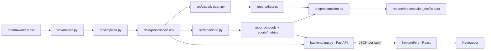
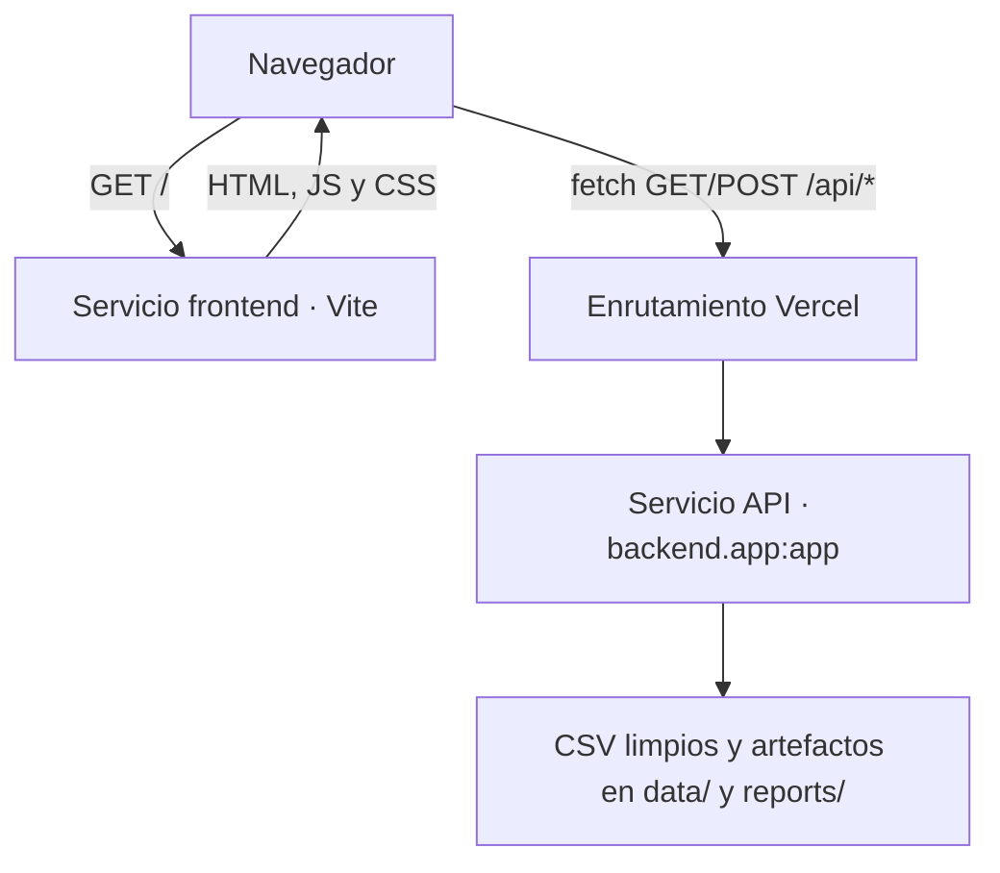
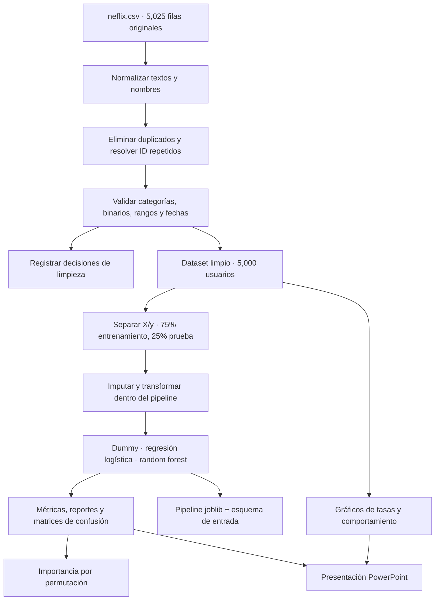

# Guía técnica del proyecto

## 1. ¿Qué hace la aplicación?

Netflix Churn Analytics es un proyecto académico que analiza un CSV de suscripciones, limpia sus datos, compara modelos que estiman la cancelación y presenta los resultados en un dashboard. La interfaz también permite enviar los datos de un perfil al modelo guardado y consultar una estimación individual.

No es una aplicación de Netflix, no consulta servicios de Netflix y no demuestra por qué una persona cancela. Las tasas e importancias son descriptivas o predictivas; no prueban causalidad. Para una predicción real también habría que comprobar que cada variable estuviera disponible antes de la cancelación.

## 2. Arquitectura en una vista

El análisis por lotes y la web son dos flujos relacionados, pero distintos: el primero genera artefactos a partir del CSV; el segundo los lee para responder solicitudes.



En el despliegue configurado, Vercel dirige `/api/*` al servicio FastAPI `pcactividad-ia-api` y las demás rutas al frontend `frontend`. Ambos servicios están declarados en [`vercel.json`](../vercel.json).



## 3. Recorrido de los datos y entrenamiento

La ejecución principal es `npm run analysis`, que invoca [`src/analisis.py`](../src/analisis.py). El orden importa:

1. Comprueba que exista el CSV de origen y calcula su hash SHA-256 para dejar constancia de qué archivo se analizó.
2. Lee el CSV original y llama a [`src/limpieza.py`](../src/limpieza.py).
3. Exporta la tabla limpia y la auditoría a `data/processed/`.
4. Genera gráficos descriptivos con [`src/visualizacion.py`](../src/visualizacion.py).
5. Prepara, compara y guarda modelos mediante [`src/modelado.py`](../src/modelado.py).
6. Construye una presentación con [`src/presentacion.py`](../src/presentacion.py).
7. Escribe `reports/metrics/analysis_run.json`, un manifiesto con la fecha, el origen, el hash, los conteos y las rutas de los resultados.



### Limpieza de datos

[`src/limpieza.py`](../src/limpieza.py) contiene estas responsabilidades:

- `normalizar_texto` quita espacios sobrantes, normaliza Unicode y devuelve valores vacíos como `None`.
- `limpiar_cadenas` aplica esa normalización a las columnas de texto seleccionadas.
- `mapear_binario` convierte variantes de “sí/no”, verdadero/falso y `1/0` a enteros anulables.
- `resolver_duplicados_usuario` conserva una fila por `id_usuario`: prioriza la fila más completa y, como desempate, la fecha de registro más reciente.
- `limpiar_dataframe` copia el DataFrame, estandariza categorías, elimina duplicados exactos, resuelve IDs repetidos, convierte el objetivo `cancelo` y valida rangos numéricos y fechas. Cada regla aplicada se agrega a una tabla de auditoría.
- `cargar_y_limpiar` lee el CSV y devuelve los datos procesados junto con su auditoría.
- `exportar_datos_limpios` guarda ambos CSV en `data/processed/`.

Los valores faltantes de las variables predictoras no se rellenan en esta etapa: los trata el pipeline durante el entrenamiento y la predicción. Las etiquetas inválidas del objetivo no se inventan ni se imputan.

### Preparación y modelos

[`src/modelado.py`](../src/modelado.py) separa las columnas predictoras `X` de la etiqueta `y = cancelo`. Excluye `id_usuario` porque identifica personas y `fecha_registro` porque no hay una fecha de corte que permita establecer si es válida como predictor.

`preparar_dataset` filtra etiquetas ausentes y separa entrenamiento/prueba con `test_size=0.25`, `random_state=42` y estratificación para conservar la proporción de clases.

`construir_preprocesador` arma transformaciones por tipo de columna:

- Numéricas: imputación por mediana y estandarización.
- Categóricas: imputación por categoría más frecuente y codificación one-hot. `handle_unknown='ignore'` permite recibir categorías no vistas al entrenar.

El preprocesamiento y el estimador se ajustan juntos en un `Pipeline` de scikit-learn. Los tres modelos comparados son:

- `DummyClassifier`: referencia sencilla que siempre predice la clase más frecuente.
- `LogisticRegression`: modelo lineal de clasificación.
- `RandomForestClassifier`: conjunto de árboles de decisión.

Se calculan exactitud, precisión, recall y F1 sobre la prueba reservada; además, F1 medio y desviación estándar mediante validación cruzada estratificada de cinco particiones sobre entrenamiento. Las matrices de confusión y los reportes clasificatorios quedan guardados para cada modelo. El pipeline que se conserva se escoge según el mayor F1 medio de la validación cruzada, se vuelve a ajustar con el entrenamiento y se guarda en `reports/models/netflix_churn_pipeline.joblib`.

`permutation_importance` mide cuánto cambia F1 al desordenar cada variable. Es una medida de utilidad predictiva dentro de esta evaluación, no de efecto causal.

## 4. Backend: API FastAPI

[`backend/app.py`](../backend/app.py) define la aplicación `app` que inicia Uvicorn y el servicio FastAPI de Vercel. Calcula las rutas de archivos desde la raíz del proyecto y lee CSV, JSON y el pipeline entrenado desde `data/` y `reports/`. La API no vuelve a entrenar el modelo al recibir una solicitud.

Funciones de apoyo:

- `json_safe`: convierte valores de NumPy/Pandas, fechas y números no finitos a tipos que JSON pueda representar.
- `read_json` y `read_clean`: leen artefactos existentes y convierten errores de lectura a respuestas HTTP explícitas.
- `pending`: representa el estado en que aún no existen resultados del análisis.
- `group_rates` y `filtered_frame`: calculan tasas por grupo y aplican filtros del dashboard.

### Rutas públicas

| Método y ruta | Uso |
|---|---|
| `GET /api/health` | Estado de la API, análisis, modelo y fecha de generación. |
| `GET /api/summary` | Usuarios analizados, cancelaciones, tasa global y hallazgos destacados. |
| `GET /api/quality` | Conteos de calidad, nulos y decisiones de auditoría. |
| `GET /api/filters` | Opciones de país, plan y dispositivo para los filtros. |
| `GET /api/segments` | Tasas y comportamiento de los segmentos; admite `country`, `plan` y `device`. |
| `GET /api/models` | Métricas, matriz/reporte, esquema de entrada y detalles de evaluación. |
| `GET /api/factors` | Importancia por permutación y notas de interpretación. |
| `POST /api/predict` | Valida las variables recibidas y ejecuta el pipeline guardado. |
| `GET /api/downloads` | Lista de archivos permitidos y disponibilidad. |
| `GET /api/downloads/{download_id}` | Descarga un resultado identificado en una lista permitida. |

La predicción comprueba que estén todos los campos esperados, que no haya campos desconocidos y que números/categorías tengan tipos válidos. Los identificadores de descarga son una lista explícita; el cliente no puede solicitar una ruta arbitraria del disco.

CORS permite los orígenes locales de desarrollo y los dominios enumerados en la variable `FRONTEND_ORIGINS`, separados por comas. Esta variable es útil si el frontend y la API se alojan en dominios distintos. Cuando ambos servicios se publican detrás de las rutas del mismo proyecto Vercel, el frontend usa `/api` en el mismo dominio.

## 5. Frontend: React y TypeScript

[`frontend/src/main.tsx`](../frontend/src/main.tsx) carga Bootstrap y los estilos propios, encuentra `#root` de `frontend/index.html` y monta React. La aplicación y la navegación se encuentran en [`frontend/src/App.tsx`](../frontend/src/App.tsx).

Al iniciar, `App` consulta en paralelo salud, resumen, calidad, filtros, modelos, factores y descargas con `Promise.all`. Guarda los resultados en estado React y, cuando cambian los filtros de país/plan/dispositivo, vuelve a solicitar los segmentos. También ofrece actualizar los datos y muestra estados de carga, error, vacío o análisis pendiente.

Las secciones de navegación se implementan así:

| Archivo | Responsabilidad visible |
|---|---|
| `pages/QualityPage.tsx` | Auditoría, conteos de limpieza y valores faltantes. |
| `pages/ExplorationPage.tsx` | Distribución, tasas por grupo y comparaciones de comportamiento. |
| `pages/ModelsPage.tsx` | Comparación de métricas y matrices de confusión. |
| `pages/FactorsPage.tsx` | Importancia de variables y advertencia sobre causalidad. |
| `pages/PredictionPage.tsx` | Formulario derivado del esquema del modelo y respuesta de predicción. |
| `pages/DownloadsPage.tsx` | Resultados descargables autorizados por la API. |

Componentes reutilizables:

- `components/MetricCard.tsx`: tarjeta de indicador.
- `components/Panel.tsx`: contenedor visual con título, descripción y contenido.
- `components/StateMessage.tsx`: mensajes homogéneos de carga, error, vacío, pendiente o éxito.

[`frontend/src/api.ts`](../frontend/src/api.ts) es el cliente HTTP central. Declara tipos TypeScript para las respuestas, construye las llamadas `/api/...`, serializa filtros y predicciones, y convierte respuestas HTTP fallidas en errores legibles. La URL base es `VITE_API_BASE_URL` o, por defecto, `/api`.

[`frontend/src/styles.css`](../frontend/src/styles.css) contiene los estilos del dashboard. `frontend/vite.config.ts` configura Vite para desarrollo local y reenvía `/api` a `http://127.0.0.1:8000`.

## 6. Archivos del repositorio

| Ruta | Qué contiene |
|---|---|
| `data/raw/neflix.csv` | Fuente original; el nombre conserva la ortografía del archivo entregado. |
| `data/processed/` | Dataset limpio y auditoría de limpieza. |
| `src/` | Limpieza, análisis orquestador, entrenamiento, gráficos y presentación. |
| `backend/` | API FastAPI que entrega resultados y recibe predicciones. |
| `frontend/` | Aplicación Vite, React y TypeScript. |
| `reports/figures/` | Gráficos exploratorios, matrices de confusión e importancia. |
| `reports/metrics/` | Métricas, reportes de clasificación, evaluación y manifiesto de ejecución. |
| `reports/models/` | Pipeline completo serializado con joblib. |
| `reports/tablas/` | Tablas agregadas para informes. |
| `notebooks/01_netflix_cancelaciones.ipynb` | Recorrido analítico en notebook; reutiliza la entrada `src.analisis.ejecutar_analisis`. |
| `tests/` | Pruebas de limpieza, separación de datos, API, predicción y descargas. |
| `scripts/` | Ayudantes de PowerShell para instalar Python, iniciar la API, ejecutar análisis y pruebas. |
| `requirements.txt` | Dependencias Python. |
| `package.json` y `package-lock.json` | Workspaces de npm, scripts y dependencias JavaScript. |
| `vercel.json` | Servicios y rutas de producción en Vercel. |
| `render.yaml` | Alternativa de despliegue de la API como servicio de Render. |
| `PC 2 Actividad 2.pdf` | PDF de la actividad. |

### Grupos de scripts

- `scripts/install_python.ps1` prepara el entorno virtual `.venv`, instala `requirements.txt` y verifica dependencias.
- `scripts/backend.ps1` comprueba que exista el entorno virtual y que el puerto 8000 esté libre; no termina procesos ajenos.
- `scripts/run_analysis.py` sirve como entrada de análisis para Python.
- `scripts/test.ps1` ejecuta las pruebas Python.

Los comandos habituales se declaran en el `package.json` de la raíz. `npm run dev` coordina frontend y backend en desarrollo; `npm run build` verifica TypeScript y genera el frontend; `npm test` ejecuta las pruebas.

## 7. Cómo ejecutarlo en Windows

Desde PowerShell, en la carpeta raíz del repositorio:

```powershell
npm install
npm run install:python
npm run analysis
npm run dev
```

Después abre <http://127.0.0.1:5173>. Vite sirve la página y reenvía las llamadas `/api` al backend local. Para comprobar cambios:

```powershell
npm run build
npm test
```

`npm run analysis` vuelve a generar los archivos procesados, métricas, modelo, gráficos y presentación usando el CSV presente. La web solo consume esos resultados; cambiar el CSV requiere volver a correr el análisis.

## 8. Despliegue

La configuración en [`vercel.json`](../vercel.json) declara:

- Servicio `pcactividad-ia-api`, con framework FastAPI y entrypoint `backend.app:app`.
- Servicio `frontend`, con framework Vite y raíz `frontend`.
- Rewrite de `/api/(.*)` a la API y de `/(.*)` al frontend.

No se declara un binding porque el navegador llama a rutas públicas del mismo dominio (`/api/...`); Vercel resuelve el rewrite. El proyecto puede desplegarse como una agrupación de **Services** desde el repositorio. Los archivos de resultados existentes se incluyen en el repositorio; si se cambia la fuente, hay que regenerarlos y volver a publicar los cambios.

`render.yaml` es una alternativa para alojar solo la API en Render. En ese escenario se configura `VITE_API_BASE_URL` en Vercel con la URL de Render seguida de `/api`, y `FRONTEND_ORIGINS` en Render con el origen del sitio.

## 9. Pruebas y límites de interpretación

[`tests/test_netflix_pipeline.py`](../tests/test_netflix_pipeline.py) comprueba dimensiones/duplicados del origen, unicidad tras limpieza y proporciones de la partición. [`tests/test_web_api.py`](../tests/test_web_api.py) valida rutas, filtros, métricas, predicción, descargas y CORS local.

En el dataset de prueba, las pruebas esperan 5,025 filas originales, 25 duplicados exactos y 5,000 filas después de resolver duplicados. Son expectativas para este archivo de origen concreto.

Una tasa alta en un grupo no significa que esa característica haya causado la cancelación. Una puntuación del modelo tampoco es una certeza individual ni necesariamente una probabilidad calibrada. El desempeño medido en una partición académica no garantiza resultados en otros usuarios, periodos o contextos.
